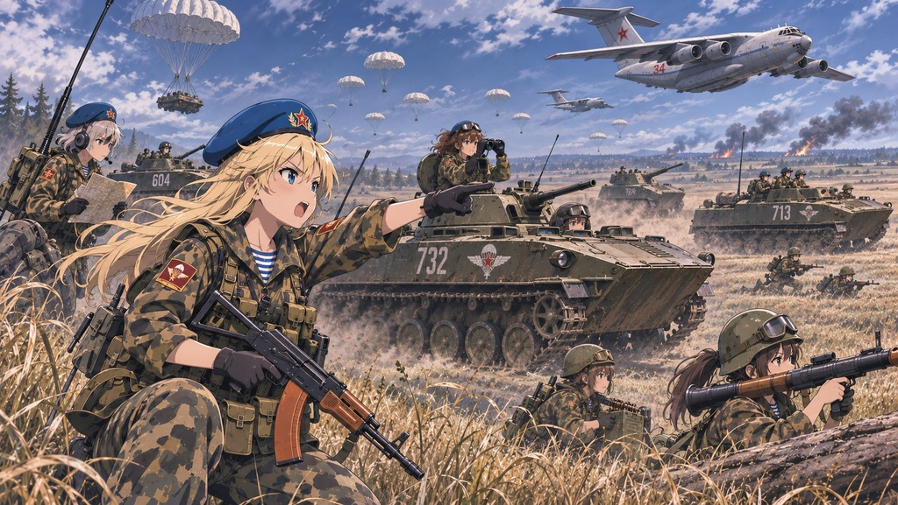

# 空降机械化与轻型装甲

《钢铁雄心 IV》模组：为师设计器增加使用原版装备的空降机械化步兵营和空降轻型坦克营。

## 模组内容

- 新增可执行空降的机械化步兵营和轻型坦克营，使用原版步兵装备、机械化装备和轻型坦克。
- 研发空降兵科技后，在决议中查看解锁选项：机械化营还需机械化步兵科技；轻型坦克营还需一战坦克或一战坦克底盘科技。决议不消耗政治点数。
- 自行在师设计器中编制部队；空降仍使用游戏的运输机、制空和任务规则。不提供预设师模板或 AI 编制。
- 支持简体中文与英文，附带独立兵种图标。

## 安装

1. 下载仓库内容，或下载并解压模组压缩包。
2. 在 Paradox 启动器中创建本地模组，将本目录内容复制到该模组目录，保留启动器生成的配置以匹配本机路径。
3. 在启动器的游玩集启用模组。

## 版本与兼容性

- 目标版本：**1.19.4.1**；描述文件声明兼容 `1.19.4.*`。
- 面向原版游戏设计，使用独立单位、决议和图标文件。与其他模组、DLC 组合及成就的兼容性尚未验证。
- 当前版本尚未完成游戏内验证。空降任务、装备补充、支援连兼容性、图标显示、存档重载及数值平衡均需实机测试。

## English

Adds airborne mechanized infantry and airborne light tank battalions using vanilla equipment. Research paratroopers and the relevant equipment technology, then use the free decisions to unlock the battalions. Design divisions yourself and use the existing transport aircraft and paradrop rules.

Target: Hearts of Iron IV **1.19.4.1**. In-game behavior and compatibility have not yet been verified. Install by creating a local mod in the Paradox Launcher, copying this repository's contents into its mod folder, and enabling it in a playset.
